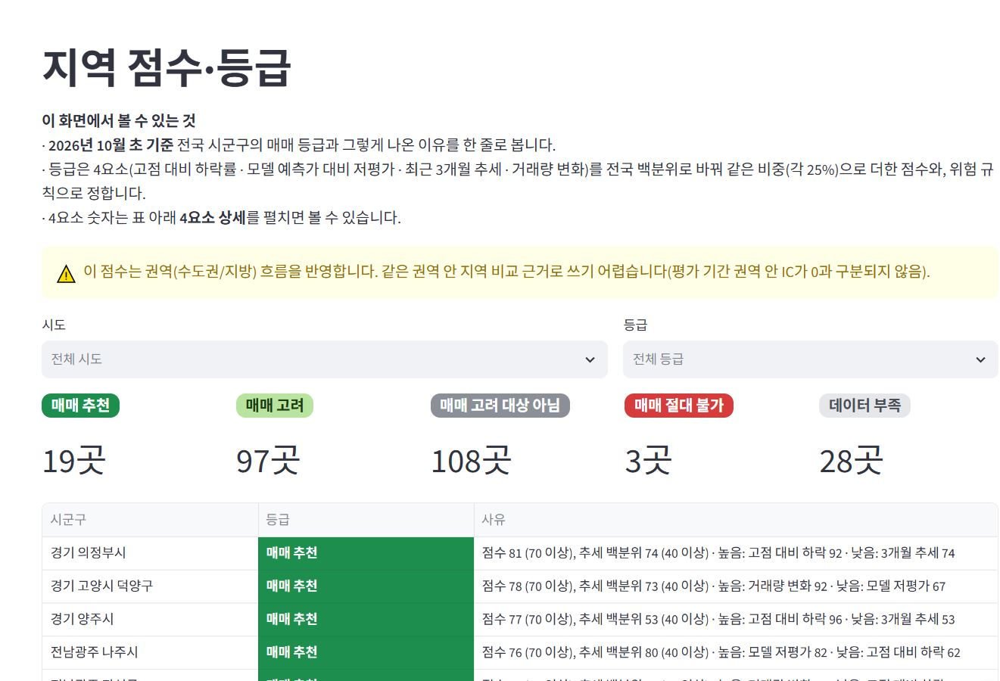
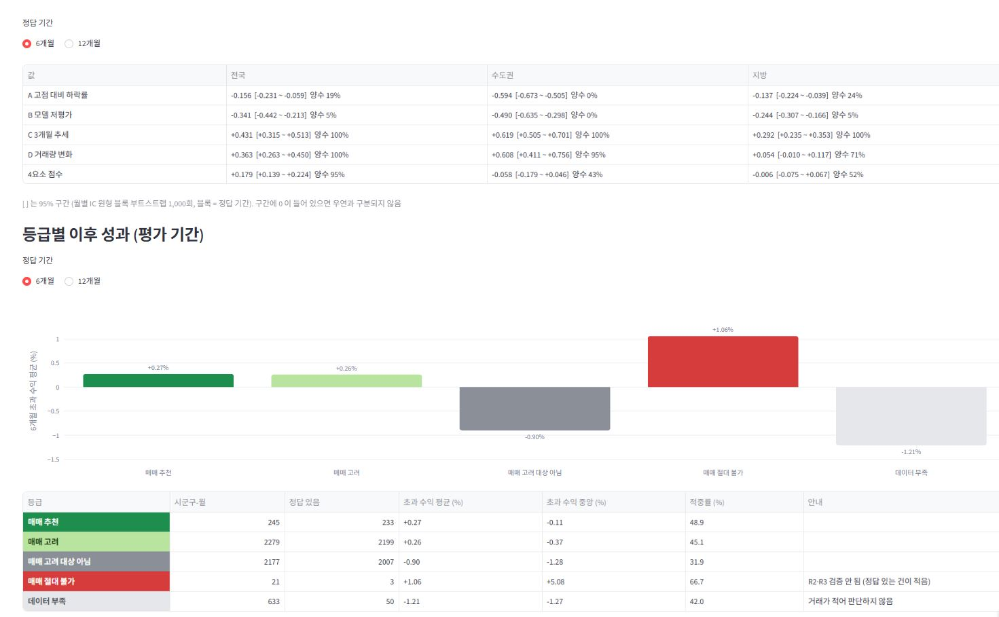
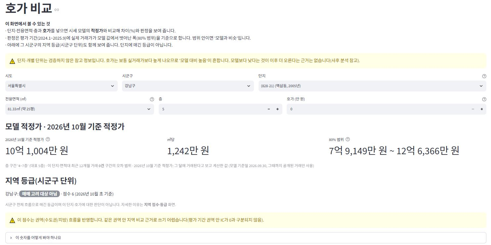

# 전국 아파트 시세 모델 · 지역 점수 · 호가 비교

> 국토부 실거래 358만 건으로 아파트 시세 모델을 만들고, 시군구 매매 점수를 **미리 정한 절차로 백테스트해 좋은 결과와 나쁜 결과를 모두 공개**한 개인 ML 프로젝트입니다.

**🔗 앱**: https://realestate-ml-fngwt58swfw5hmbaf7jt5t.streamlit.app/ <!-- MVP 5 공개 후 주소 확인 -->

| 지역 점수·등급 | 백테스트 성적표 | 호가 비교 |
|---|---|---|
|  |  |  |
<!-- 캡처 자리: docs/images/ (region_score.jpg, backtest.jpg, quote_compare.jpg, complex_price.png, api_docs.png) -->

> **투자 권유가 아닙니다.** 공공 데이터를 가공한 개인 포트폴리오용 분석 결과이며, 정확성을 보장하지 않습니다.

---

## 무엇을 했나

| 단계 | 내용 |
|---|---|
| 데이터 | 국토부 아파트 매매 실거래 **3,580,178건** (2020.1~2026.10, 해제 신고 포함 / 정상 거래 340만 건): 공개시스템 CSV + 공공데이터 API 백필(하루 한도에서 멈추고 이어받기). 한국부동산원 **R-ONE** 매매가격지수·실거래가격지수 |
| 시세 모델 | **LightGBM**, 피처 29개 (단지·면적·층·연식, 단지/법정동 최근 시세, 시군구 추세·거래량·해제 비율, R-ONE 변화율). 분기마다 다시 학습하는 walk-forward |
| 지역 점수 | 전국 255개 시군구에 매달 4요소(고점 대비 하락, 모델 대비 저평가, 3개월 추세, 거래량 변화) 점수 + 위험 규칙 → 등급 4개 + "데이터 부족" |
| 단지 시세 | 단지별 최근 12개월 실거래 ㎡당 중위가 vs 모델 적정가 (정보용, 등급 없음, 5건 미만은 가격 비움) |
| 호가 비교 | 단지·면적·층·호가 입력 → **2026년 10월 기준 적정가**, 80% 오차 범위, "모델 대비 높음/비슷/낮음" |
| API (로컬) | **FastAPI** `POST /predict` (가격 예측), `GET /region/{sgg_cd}` (지역 등급), `GET /health`. 모델은 MLflow Registry `apt_price_lgbm` 에서 로드 |

## 핵심 결과

### 시세 모델 — 평가 기간 2024.1~2025.9 (거래 816,682건, 설정 고정 뒤 1회)

| 모델 | MAPE | MdAPE | ±10% 이내 | MAE |
|---|---:|---:|---:|---:|
| B0 법정동 최근 ㎡당 중위가 × 면적 (부족하면 시군구·시도) | 25.49% | 15.29% | 36.5% | 1억 202만 원 |
| B1 같은 단지·면적대 중위가 (지수 보정) | 10.26% | 6.48% | 67.8% | 4,298만 원 |
| **LightGBM** | **6.30%** | **4.30%** | **82.2%** | **2,848만 원** |

- B1 대비 MAPE −3.96%p (95% 구간 −4.39 ~ −3.57, 월 단위 블록 부트스트랩). 이후 확인 기간(2025.10~2026.8)도 6.40%로 비슷
- 상세: [reports/lgbm.md](reports/lgbm.md), [reports/baselines.md](reports/baselines.md)

### 지역 점수 — 결과가 좋은 부분과 나쁜 부분 모두

IC = 매달 시군구 점수 순위와 이후 실제 초과 수익 순위의 상관 (−1 ~ +1).

| 평가 2024.1~2025.9, 6개월 뒤 | IC 평균 [95% 구간] |
|---|---|
| 전국 | **+0.179** [+0.139 ~ +0.224], 21개월 중 95%가 양수 |
| 수도권 안에서만 | −0.058 [−0.179 ~ +0.046] → **0과 구분 안 됨** |
| 지방 안에서만 | −0.006 [−0.075 ~ +0.067] → **0과 구분 안 됨** |

- 미리 정한 판정 3개(IC > 0, 추천 − 고려 대상 아님 > 0, 단순 기준보다 나음)는 모두 통과했습니다.
- 하지만 **사후 분석에서 점수의 순위 정보는 거의 다 "수도권 vs 지방" 차이**였습니다. 같은 권역 안 지역을 고르는 근거로는 못 씁니다 → 화면에 이 안내를 항상 붙였습니다.
- "많이 내린 곳(A)"과 "모델보다 싸게 거래된 곳(B)"은 이후 오히려 **덜 올랐습니다** (평가 IC −0.156, −0.341). 그래서 단지 시세·호가 화면은 "싸다/비싸다" 판단 없이 정보로만 보여 줍니다.
- "매매 추천"과 "매매 고려"의 수익 차이는 구분되지 않았고, 하락 규칙 R2는 평가 기간에 하락기가 없어 검증되지 않았습니다.
- 이 결과를 보고 설정을 고치지 않았습니다. 다음 버전 과제로 따로 적었습니다 → [reports/score_backtest.md](reports/score_backtest.md) 6·7장

## 검증 절차 (결과를 보기 전에 정한 것)

- **시점 누수 방지**: 계약월 M의 피처는 기준일 C(M) = (M−1월 말일) − 30일까지 **신고·공개됐을 거래와 해제만** 씁니다 (신고 기한 30일). R-ONE은 발표 지연만큼 늦춥니다. 피처 생성 기록을 `asof.audit` 가 검사해 어기면 학습이 멈춥니다.
- **기간 분리**: 튜닝 2023 (모델) / 2022.2~2023.4 (점수) → 평가 2024.1~2025.9 → 확인 2025.10~ (참고). 튜닝 기간 안에서 후보(모델 12개, 가중치 5개)를 고르고 설정을 파일로 고정
- **평가는 1회**: 같은 설정의 평가 기록이 MLflow에 있으면 다시 실행을 거부합니다.
- **규칙 조정은 1회만, 기록으로 남김**: 튜닝 결과를 본 뒤(평가 전) "데이터 부족"을 매매 절대 불가에서 빼고 따로 표시 (2026-11-02, `rule_version` 2, [PLAN.md](PLAN.md) 13장). 그 뒤로는 결과를 보고 설정·경계·규칙을 바꾸지 않습니다.
- 판정 기준·우연 여부(블록 부트스트랩, 무작위 등급 1,000회)·권역별 분석을 리포트에 그대로 남겼습니다.

## 구조 (비용 0원)

```
 로컬 PC (8GB)                                            클라우드 (무료)
┌───────────────────────────────────────────────┐
│ 국토부 CSV·API, R-ONE                          │
│   → Parquet (원본·정리본, git 제외)            │
│   → DuckDB 피처 계산 (시점 규칙)               │
│   → LightGBM 학습·백테스트 ── MLflow 기록·Registry│
│   → 점수·등급·집계표                           │      ┌────────────────────┐   읽기 전용      ┌──────────────────┐
│   → publish.py (쓰기 계정, 집계만) ────────────┼────▶ │ TiDB Cloud Starter │ ◀─── web_ro ──── │ Streamlit        │
│                                               │      │ 공개 집계표만      │                  │ Community Cloud  │
│ FastAPI (로컬 전용): /predict /region /health  │      └────────────────────┘                  └──────────────────┘
└───────────────────────────────────────────────┘
```

- 공개되는 것은 **집계표와 모델 출력뿐**입니다. 개별 거래 행·내부 단지 키·모델 파일·API 키는 올라가지 않습니다 (업로드 스크립트가 거래 단위 열이 있으면 거부, 단지는 한 번 더 해시한 공개 ID).
- DB 계정을 둘로 나눴습니다: 업로드용 쓰기 계정(로컬 `.env`)과 앱용 `web_ro`(SELECT만). 앱은 접속 계정에 쓰기 권한이 있으면 실행을 멈춥니다.
- 커밋마다 비밀값 검사(pre-commit 훅). 비용: TiDB Cloud Starter 무료, Streamlit Community Cloud 무료, MLflow 로컬 SQLite.

## 실행 방법

의존성은 **uv** (`pyproject.toml` + `uv.lock`)로만 관리합니다. Python 3.12.

```powershell
uv sync                                        # 가상환경·패키지 설치
uv run streamlit run app/Home.py               # 화면 http://localhost:8501 (data/public Parquet, 또는 Secrets 의 TiDB)
uv run uvicorn realestate.api.app:app          # API 문서 http://127.0.0.1:8000/docs
uv run pytest                                  # 테스트 (117개)
```

<details>
<summary>데이터부터 다시 만들기 (원본 CSV·API 키 필요)</summary>

```powershell
uv run python scripts/build_rone.py            # R-ONE CSV → Parquet
uv run python scripts/import_molit_csv.py      # 실거래 CSV → Parquet
uv run python scripts/backfill_molit_api.py    # 공공데이터 API 백필 (.env 의 DATA_GO_KR_KEY)
uv run python scripts/build_features.py        # 시점 안전 피처표
uv run python scripts/train_lgbm.py backtest   # walk-forward 학습·평가 (MLflow 기록)
uv run python scripts/score_backtest.py        # 지역 점수 튜닝·평가
uv run python scripts/build_public.py          # 공개 집계표
uv run python scripts/build_fair_price.py train # 호가 비교용 모델 (기준일 2026.9.30) → register → grid
uv run python scripts/publish.py --dry-run     # TiDB 업로드 전 표·열·행 수 확인
```
`requirements.txt` 는 Streamlit Cloud 용으로 `uv export` 로 만든 파생 파일입니다.
</details>

<details>
<summary>API 예시 — POST /predict</summary>

```json
// 입력
{"complex_id": "c_847b9c03e5", "area_m2": 84.99, "floor": 12, "ask_price_manwon": 310000}
// 출력 (일부)
{"price_basis": "2026년 10월 기준 적정가",
 "model": {"name": "apt_price_lgbm", "anchor": "2026-09-30", "registry_version": "1"},
 "fair_price_manwon": 296227,
 "range_80": {"low_manwon": 274071, "high_manwon": 320238, "history_group": "20건 이상"},
 "ask_gap_pct": 4.6, "judgement": "모델과 비슷", "judgement_note": null,
 "region": {"label": "지역 등급(시군구 단위)", "grade": "매매 고려 대상 아님", "notice": "이 점수는 권역(수도권/지방) 흐름을 반영합니다. ..."},
 "notice": "단지·개별 단위는 검증하지 않은 참고 정보입니다. ..."}
```
</details>

## 한계와 v2 계획

**한계**
- 지역 점수는 권역 안 비교 근거가 되지 못함 (위 IC). "추천"과 "고려"의 차이도 확인되지 않음
- 단지·호가 비교는 단지 단위로 검증하지 않은 참고 정보. 오차 범위는 평가 기간 분포를 빌려 씀 (기준일 2026.9.30 모델 자체는 평가 전)
- 모델이 모르는 것: 동·향·수리 상태·조망. 거래비용·세금 미반영. 평가 기간에 하락기가 없어 하락 규칙(R2) 미검증

**v2 계획** ([PLAN.md](PLAN.md) "v2 계획")
- 온비드 공매 연동 (할인율·유찰·권리 → 입찰 등급)
- 단지 단위 등급: 단지 단위 백테스트(사전 등록 → 튜닝 → 평가)를 따로 통과한 뒤에만
- Docker (앱 + API 이미지 1개, compose)
- 재학습·수집 자동화, 모니터링 (오차 추이, 피처 분포 변화), MLflow `production` 별칭
- 지역 점수 다음 버전: 2026.10 이후 새 데이터로 재검증, 권역 안 백분위, A·B 요소 방향 재검토

## 출처

- 국토교통부 실거래가 공개시스템 · 공공데이터포털 아파트 매매 실거래가 API
- 한국부동산원 R-ONE 부동산통계정보 (reb.or.kr/r-one)

---

이 프로젝트는 Claude Code를 활용해 개발했고, 설계·검증 기준과 판단은 본인이 했습니다.

**투자 권유가 아닙니다. 공공 데이터 기반 분석 결과입니다.**
